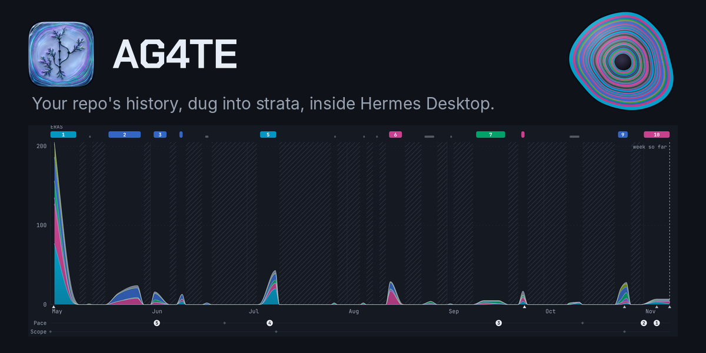

# AG4TE for Hermes



You know a repository's code, but not the story of how it got that way: when the work happened, what kind of work it was, who did it, and where it went quiet. AG4TE digs a local git repository's history with DevArch and draws that story as strata in Hermes Desktop.

A dig gives you:

- commits per day, split by kind of work (features, fixes, docs, tests, chores and the rest)
- the repo drawn as a cut agate: one band per era, oldest at the rim and newest at the core, band thickness following √commits, and each band split by kind of work in time order, every kind at its exact share of that era's commits
- eras, quiet gaps and notable signals
- weekly rhythm and practice health
- authors merged across name spellings and split into people, agents and bots

Digs run on your machine. They read only the repository you choose, keep their results under `plugin-data/ag4te`, and never call an LLM. The only network access is `uvx` fetching the pinned DevArch commit and its Python dependencies the first time.

## What you get

- **Desktop:** an AG4TE page. Pick a repository under your `repo_roots`, start a dig, watch its steps, and read the stone, a short Story of the repo in plain words, and the strata chart (Days, Weeks or Months), eras, gaps, signals, rhythm and authors. A running dig can be stopped and resumed.
- **Slash command:** `/ag4te list | show <project> | status <project> | dig <repo-path> [project] | stop <project> | resume <project> | unlock`. On Telegram, Discord and any platform AG4TE doesn't know as local, `dig`, `resume`, `stop` and `unlock` are off because they act on local files, unless `allow_dig_on_gateway: true`. There, list results contain only counts and states, and show/tool summaries omit project names, paths, error text and author names.
- **One dig at a time:** `dig.lease` in the workspace holds the rule across Hermes processes that share it. Same-host leases are checked against the process and boot when available; every lease expires after 24 hours, including leases whose live process has no verifiable start time. `/ag4te unlock` removes an expired lease if its file remains and refuses to remove an active lease. Two repositories with the same folder name get separate projects; the second one's name ends in a short path hash.
- **Agent tools:** `ag4te_dig` gives agents a read-only summary of a finished dig, or lists the digs; `ag4te_show` points the page at a section and optional item id (see [the skill](skills/ag4te/SKILL.md)). The page reacts to agent tool calls and dig progress via local Desktop events containing only ids, states and counts; no Desktop client means no visual update. Pass `detail: full` to `ag4te_dig` for the whole dig (eras, signals, authors); it is large, so it is off by default, and chat platforms always get the summary.

## Install

AG4TE lives in the `plugins/ag4te-hermes` folder of [KyaniteLabs/ag4te](https://github.com/KyaniteLabs/ag4te). Link it into your Hermes plugins folder and enable it:

```
git clone https://github.com/KyaniteLabs/ag4te.git
ln -s "$PWD/ag4te/plugins/ag4te-hermes" "${HERMES_HOME:-$HOME/.hermes}/plugins/ag4te"
hermes plugins enable ag4te
```

You also need [`uv`](https://docs.astral.sh/uv/) on the gateway host, because AG4TE runs DevArch with `uvx`. Requires Hermes `>= 0.21.6`. If Hermes Desktop connects to a remote gateway, install AG4TE on the gateway host. Desktop loads the page from there.

Check that AG4TE is on in Desktop **Capabilities -> Plugins**; enabling it there is the one step a person does, then open the AG4TE page.

## Plugin development

The Desktop file is plain ESM with no build step or separate source bundle. Run the full plugin suite with `python3 -m pytest plugins/ag4te-hermes/tests --tb=short -q`; it includes Node checks for stone layout and pane events, which can also run with `node plugins/ag4te-hermes/tests/pane-events.test.cjs`.

## Settings

Set these in Desktop (**Settings → Plugins → AG4TE**) or with `hermes config set plugins.entries.ag4te.settings.<name> <value>`.

| Setting | Default | What it does |
|---|---|---|
| `repo_roots` | `~/workspaces` | Folders (comma separated) that repositories must sit under. |
| `time_zone` | host zone | IANA zone for bucketing days and hours, e.g. `America/Los_Angeles`. |
| `history` | `head` | `head` reads the current branch; `all` reads every branch and tag. |
| `bots` | none | Extra bot or service accounts, names or emails, `*` wildcards allowed. |
| `timeout_seconds` | `600` | Time limit for each DevArch step. |
| `data_dir` | `<HERMES_HOME>/plugin-data/ag4te` | Where digs are stored. |
| `devarch_command` | pinned `uvx` install | Override how DevArch is run, for example a local checkout. |
| `allow_dig_on_gateway` | `false` | Allow `/ag4te dig`, `resume` and `stop` from chat platforms. |

## What the numbers mean

Kinds of work come from commit messages and changed paths. They are keyword heuristics, not a reading of the code. Signals and eras are leads to investigate, not conclusions. The Story card is written by fixed rules from the same numbers (origin, shape, biggest push, turning points, who built it, the work, now), so the same dig always reads the same; no model writes it. Commit counts are not a productivity measure. See [docs/DATA-MODEL-ROAST.md](docs/DATA-MODEL-ROAST.md) for how the data model was reviewed and fixed.

## Known issues

- The first dig downloads DevArch with `uvx`: the commit of this repository named by `DEVARCH_PIN` in `__init__.py` (now `d884f9a5cdd3b6d03e95114e860cc134d5067b84`), plus its Python dependencies (`click`, `sqlite-utils`, `datasette` and their dependency trees) from PyPI. The default command passes `--constraints devarch-constraints.txt`, which pins every package in that tree to an exact version (generated for that commit; the file header shows how to regenerate it when `DEVARCH_PIN` moves). Third-party code from PyPI still runs on the gateway host the first time, and again if `uv`'s cache is cleared. The pins are versions only: `uvx` has no `--require-hashes`, and it does not check hashes placed in a constraints file (a corrupted hash was accepted when tried), so file hashes are not verified. A command you set in `devarch_command` replaces the default and its pins. `uv` also keeps its own package cache (default `~/.cache/uv`) outside `plugin-data/ag4te`.
- **What the DevArch child can see.** AG4TE runs DevArch with a scrubbed environment: only an allow-list reaches it (`PATH`, `HOME`, locale, temp and XDG folders, plus the variables below). `uvx` downloads and runs DevArch in a single process, so the credentials a download needs cannot be kept out of the process that runs the downloaded code. These package-manager and network variables are passed through because the download needs them: `UV_CACHE_DIR`, `UV_PYTHON`, `UV_INDEX_URL`, `UV_EXTRA_INDEX_URL`, `PIP_INDEX_URL`, `HTTP_PROXY`, `HTTPS_PROXY`, `NO_PROXY`, `http_proxy`, `https_proxy`, `no_proxy`, `SSL_CERT_FILE`, `SSL_CERT_DIR` and `REQUESTS_CA_BUNDLE`. A registry or proxy URL that embeds a credential is therefore visible to DevArch and its dependencies. Use a mirror that needs no secret in the URL, or set `devarch_command` to an already-installed DevArch. Never passed: `PYTHONSTARTUP`, `PYTHONPATH`, `PYTHONHOME`, `NODE_OPTIONS` and other code-injection variables, `LD_PRELOAD`, `DYLD_*`, `GIT_ASKPASS`, API keys and tokens. A test sets sentinel values for all of these and checks the child sees none of the blocked ones.
- Kinds of work are keyword heuristics from commit messages and paths, not a reading of the code.

## Privacy

A dig records the commit author names and emails of the repository you choose, stores them under `plugin-data/ag4te` on the gateway host, and shows author names on the Desktop page. The dig itself sends nothing anywhere. When an agent calls `ag4te_dig`, the summary it gets back, including the authors, becomes part of that conversation and goes to the model provider Hermes is configured to use. Dig only repositories whose contributor details you are fine handling that way. Delete a dig's folder under `plugin-data/ag4te` to remove it.

## License

Apache-2.0 for the plugin code. See [LICENSE](LICENSE).

The Desktop page embeds two WOFF2 subsets of the Chakra Petch typeface
(SIL Open Font License 1.1), (c) 2018 The Chakra Petch Project Authors.
The font is not Apache-2.0. See [THIRD-PARTY-NOTICES.md](THIRD-PARTY-NOTICES.md).

AG4TE is an independent project by KyaniteLabs and is not endorsed by Nous Research.
